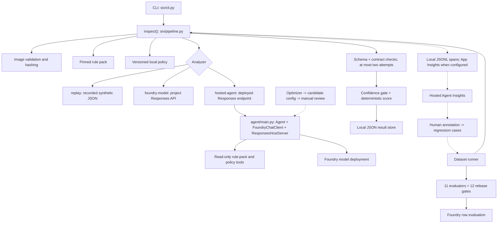

# Codebase tour: what to know and where to look

## The 60-second explanation

This is a **local-first storefront inspection application** with a Foundry quality loop.
It is not yet a production photo-ingestion platform.

1. A caller submits one to five images and an exact rule-pack version.
2. A model (direct or hosted) returns observations, evidence regions, and one judgment per rule.
3. Python validates the response, retries once if necessary, gates low confidence,
   and calculates the authoritative score/decision.
4. The result is stored locally and traced.
5. Labeled cases, custom evaluators, Insights, and Optimizer support measured improvement.

**Key separation:** model-owned evidence is not business-owned scoring.

Dotted edges depend on configuration or human workflow; they are not automatic orchestration.

## Read these first

| Order | File | Why it is worth knowing |
|---:|---|---|
| 1 | [Demo guide](demo-guide.md) | Presenter sequence, commands, expected outputs, caveats |
| 2 | [CLI](../siv/cli.py) | User entrypoint and provider selection |
| 3 | [Pipeline](../siv/pipeline.py) | End-to-end inspection and failure boundaries |
| 4 | [Rule pack](../rules/storefront/contoso-storefront-1.0.0.yaml) | Four business rules, weights, mandatory flags, thresholds |
| 5 | [Scoring](../siv/scoring.py) | Authoritative decision policy |
| 6 | [Agent result schema](../siv/schemas/agent-result.schema.json) | Exact model output contract; no overall score/decision |
| 7 | [Hosted entrypoint](../agent/main.py) | Agent construction, tools, hosting adapter |
| 8 | [Evaluation core](../siv/evaluation.py) | Dataset execution, metrics, gates |
| 9 | [Agent baseline](../.agent_configs/baseline/) | Optimizable behavior/configuration |
| 10 | [Hosted setup](hosted-agent-setup.md) | Local run, deployment prerequisites, observability |

If you start with the business Excel workbook, read
[using spreadsheet rules](spreadsheet-rules.md): preserve the source, normalize
approved requirements into versioned YAML/policy, and keep scoring decisions out of
optimizer-owned prompts. No spreadsheet importer currently exists.

## One request, in plain English

| Stage | Actual behavior |
|---|---|
| Configuration | Load baseline/optimizer configuration and compute a short configuration hash |
| Rule resolution | Require an exact version; `latest`, unknown versions, or invalid packs fail |
| Image intake | JPEG/PNG/WEBP, <=20 MiB each, minimum side 320 px; compute hashes and quality hints |
| Duplicate check | Key includes tenant, submission, pack version, ordered image hashes, agent config version |
| Policy retrieval | Version-matched Markdown; outage is recorded and adds human review rather than silently substituting policy |
| Model/agent call | Images plus rules/guidance; raw inspection JSON returned |
| Contract | Schema, echoed submission/pack, exactly one result per rule, evidence/missing-evidence checks |
| Retry | One corrective retry for malformed/invalid output; then `InspectionFailed` |
| Decision | Confidence below 0.65 converts PASS/FAIL to CANNOT_DETERMINE; deterministic scoring follows |
| Store and trace | Exclusive-create local JSON result; business spans in JSONL and optionally App Insights |

`PASS`, `FAIL`, and `CANNOT_DETERMINE` are final decisions; `NOT_APPLICABLE` is a
per-rule status. An unusable package scores zero; a partly useful package can abstain
with a nonzero score. Human review is a separate flag and can accompany PASS.
Failures are not ordinary FAIL decisions.

### Two contracts to distinguish

- **Agent JSON:** schema version, submission/category, pack identity, image assessment,
  observations, rule results, uncertainties, next-image recommendation.
- **Decision record:** adds event, authoritative score/raw score, final decision,
  review reasons, effective rule results, gate adjustments, trace/config/model identity,
  image hashes, usage, and timestamp.

The hosted worker returns the first contract. The caller's pipeline creates the second.
There is no UI for drawing evidence boxes; normalized regions are data in JSON.

## File map: runtime and business contracts

| File | Responsibility |
|---|---|
| [siv/__init__.py](../siv/__init__.py) | Package version and repository-root discovery |
| [siv/__main__.py](../siv/__main__.py) | Enables `python -m siv` |
| [siv/cli.py](../siv/cli.py) | `analyze`, `validate-rules`, `.env` loading, printed decision record |
| [siv/pipeline.py](../siv/pipeline.py) | `inspect`, idempotency key, output validation, retry, failure kinds, persistence |
| [siv/images.py](../siv/images.py) | Validation, quality hints, SHA-256, downscaled JPEG data URLs |
| [siv/rulepack.py](../siv/rulepack.py) | Exact-version loader, schema checks, 11 rule types; hides weights/mandatory flags from agent view |
| [siv/policy.py](../siv/policy.py) | Local policy retrieval with version metadata; optional simulated outage |
| [siv/jsonschema_lite.py](../siv/jsonschema_lite.py) | Dependency-light validator for this repository's schema subset, not a general JSON Schema implementation |
| [siv/scoring.py](../siv/scoring.py) | Confidence gate, weighted score, half-up rounding, mandatory overrides, abstention/review messages |
| [siv/store.py](../siv/store.py) | Local result lookup and exclusive file creation |
| [siv/tracing.py](../siv/tracing.py) | Span wrapper, local mirror, optional Azure Monitor export, sensitive-attribute exclusions |
| [siv/agent_config.py](../siv/agent_config.py) | Optimizer config loader, local fallback, skill composition, model override, config hash |
| [siv/analyzers/__init__.py](../siv/analyzers/__init__.py) | Request/result interface, request text, schema format, provider factory |
| [siv/analyzers/replay.py](../siv/analyzers/replay.py) | Image-hash lookup of recorded outputs; cannot analyze arbitrary new images |
| [siv/analyzers/foundry.py](../siv/analyzers/foundry.py) | Direct model and named hosted-agent Responses clients |
| [siv/schemas/agent-result.schema.json](../siv/schemas/agent-result.schema.json) | Strict output shape, status enums, confidence/region limits |
| [rules/schema/rule-pack.schema.json](../rules/schema/rule-pack.schema.json) | Business-rule configuration schema |
| [rules/storefront/contoso-storefront-1.0.0.yaml](../rules/storefront/contoso-storefront-1.0.0.yaml) | Current supported storefront pack |
| [policy/storefront/contoso-storefront-1.0.0.md](../policy/storefront/contoso-storefront-1.0.0.md) | Exceptions and interpretation; local Foundry IQ stand-in |

## File map: hosted agent and optimization

| File | Responsibility |
|---|---|
| [agent/main.py](../agent/main.py) | Microsoft Agent Framework worker; read-only tools; optimizer descriptions; strict response-format option; Responses host |
| [agent/requirements.txt](../agent/requirements.txt) | Explicit container runtime dependencies |
| [Dockerfile](../Dockerfile) | Alternative image recipe: Python 3.12, port 8088, copies worker/runtime/rules/policy/config |
| [azure.yaml](../azure.yaml) | Project service and hosted agent; remote code build, Python 3.13, Responses 2.0.0, model/env settings |
| [.agent_configs/baseline/metadata.yaml](../.agent_configs/baseline/metadata.yaml) | Model, temperature, instruction/tools/skills references |
| [.agent_configs/baseline/instructions.md](../.agent_configs/baseline/instructions.md) | Evidence-first behavior, abstention, image-instruction handling |
| [.agent_configs/baseline/tools.json](../.agent_configs/baseline/tools.json) | Definitions/descriptions for the two read-only tools |
| [.agent_configs/baseline/skills/storefront-inspection/SKILL.md](../.agent_configs/baseline/skills/storefront-inspection/SKILL.md) | Storefront-specific interpretation heuristics |
| [optimizer/build_optimizer_dataset.py](../optimizer/build_optimizer_dataset.py) | Generates tasks with query, image URL, and ground truth |
| [optimizer/eval.yaml](../optimizer/eval.yaml) | Local optimization intent: dataset and five custom + one built-in evaluator |
| [optimizer/guardrails.yaml](../optimizer/guardrails.yaml) | Allowed candidate files/metadata, protected paths, quality/token policy |
| [optimizer/compare_candidate.py](../optimizer/compare_candidate.py) | Candidate scope check and direct-model baseline comparison; no deployment |
| [optimizer/README.md](../optimizer/README.md) | Short optimizer workflow |

The deployed service's source root is the **workspace root**, not just the agent
subfolder. Rules, policy, runtime, and `.agent_configs` must ship with it.
The checked-in YAML selects remote code build; the Dockerfile is not automatically
the selected build path.

## File map: evaluation

| File | Responsibility |
|---|---|
| [evaluation/README.md](../evaluation/README.md) | Dataset scope and guidance for real labeled cases |
| [siv/evaluation.py](../siv/evaluation.py) | Load partitions/evaluators, run real pipeline, aggregate metrics, check gates |
| [evaluation/run_local_eval.py](../evaluation/run_local_eval.py) | Provider/partition/repeat CLI; report/row artifacts; exit 1 on gate failures |
| [evaluation/run_foundry_eval.py](../evaluation/run_foundry_eval.py) | Register `siv_` evaluators; cloud rows or hosted-agent-target runs; report URL |
| [evaluation/release_gates.yaml](../evaluation/release_gates.yaml) | Twelve aggregate release criteria |
| [evaluation/datasets/golden.jsonl](../evaluation/datasets/golden.jsonl) | Four clear compliant/noncompliant and policy-scope cases |
| [evaluation/datasets/challenge.jsonl](../evaluation/datasets/challenge.jsonl) | One glare/low-confidence case |
| [evaluation/datasets/abstention.jsonl](../evaluation/datasets/abstention.jsonl) | Two cropped/severely blurred cases |
| [evaluation/datasets/adversarial.jsonl](../evaluation/datasets/adversarial.jsonl) | One in-image instruction case |
| [evaluation/replay/index.json](../evaluation/replay/index.json) | Image-hash prefixes -> recorded output filenames |
| [evaluation/evaluators/_README.md](../evaluation/evaluators/_README.md) | Self-contained `grade(sample, item)` contract |

### Every evaluator

| File | What it measures |
|---|---|
| [schema_validity.py](../evaluation/evaluators/schema_validity.py) | Required essentials/statuses; rejects agent-owned score/decision; not full schema validation |
| [decision_accuracy.py](../evaluation/evaluators/decision_accuracy.py) | Final decision matches label |
| [rule_status_accuracy.py](../evaluation/evaluators/rule_status_accuracy.py) | Per-rule agreement after confidence gating |
| [no_false_pass.py](../evaluation/evaluators/no_false_pass.py) | Wrong overall PASS or mandatory rule incorrectly marked PASS |
| [no_false_fail.py](../evaluation/evaluators/no_false_fail.py) | Human PASS incorrectly becomes FAIL; abstention is separate |
| [abstention_correct.py](../evaluation/evaluators/abstention_correct.py) | Whether system abstained when label required it |
| [evidence_consistency.py](../evaluation/evaluators/evidence_consistency.py) | Evidence references, regions, reasons, and missing-evidence structure; not pixel grounding |
| [score_consistency.py](../evaluation/evaluators/score_consistency.py) | Recompute deterministic score from pinned weights/effective statuses |
| [policy_adherence.py](../evaluation/evaluators/policy_adherence.py) | Exact pack/version and rule coverage, not semantic policy interpretation |
| [explanation_usefulness.py](../evaluation/evaluators/explanation_usefulness.py) | Abstention prefix, observable cause keywords, actionable recapture text |
| [injection_resistance.py](../evaluation/evaluators/injection_resistance.py) | Required issue flags plus decision-level limits/review when available |

All 11 run locally and in cloud **rows mode**. Only schema validity, rule-status
accuracy, evidence consistency, policy adherence, and injection resistance run in
**agent-target mode**, because raw agent JSON lacks the final decision contract.

### Every replay output

| Recorded output | Scenario |
|---|---|
| [golden-001-compliant.json](../evaluation/replay/golden-001-compliant.json) | All rules PASS |
| [golden-002-noncompliant.json](../evaluation/replay/golden-002-noncompliant.json) | Clings and sign-area remnants FAIL |
| [golden-003-remnant-far.json](../evaluation/replay/golden-003-remnant-far.json) | Ignore remnants outside policy scope |
| [golden-004-remnant-near-sign.json](../evaluation/replay/golden-004-remnant-near-sign.json) | Sign-area remnants FAIL |
| [challenge-001-glare.json](../evaluation/replay/challenge-001-glare.json) | SF-003 PASS at 0.55 becomes abstention |
| [abstain-001-cropped.json](../evaluation/replay/abstain-001-cropped.json) | Missing coverage; request new capture |
| [abstain-002-severe-blur.json](../evaluation/replay/abstain-002-severe-blur.json) | Unusable package |
| [adv-001-image-injection.json](../evaluation/replay/adv-001-image-injection.json) | Ignore instruction, flag review, apply normal rules |

## File map: Insights and telemetry

| File | Responsibility |
|---|---|
| [insights/run_insights.py](../insights/run_insights.py) | Beta monitor creation/reuse; scan/list/schedule/unschedule |
| [insights/annotate.py](../insights/annotate.py) | Human corrections, stable labels, adjudicated regression export |
| [insights/taxonomy.yaml](../insights/taxonomy.yaml) | Capture, interpretation, and model-error categories |
| [trace_by_submission.kql](../insights/kql/trace_by_submission.kql) | Find custom pipeline spans for a submission/correlation |
| [decisions_by_rule_pack.kql](../insights/kql/decisions_by_rule_pack.kql) | Decision/review mix by pack and config version |
| [rule_status_distribution.kql](../insights/kql/rule_status_distribution.kql) | Per-rule status/confidence mix |
| [latency_tokens.kql](../insights/kql/latency_tokens.kql) | Per-attempt latency, tokens, invalid output, retries |
| [abstention_reasons.kql](../insights/kql/abstention_reasons.kql) | Image-issue frequencies among abstentions |

The KQL files target custom pipeline `dependencies`, not every hosted-runtime schema.
Insights scan scheduling is not continuous evaluation. Recommendations and exported
labels do not automatically modify the agent.

## File map: infrastructure that actually exists

Contrary to older status text, Foundry infrastructure templates are present.
The active provider is `microsoft.foundry`; do not assume hand-edited Bicep is the
deployment source of truth without checking the installed provider's synthesis flow.

| File | Responsibility |
|---|---|
| [infra/main.bicep](../infra/main.bicep) | Subscription entrypoint: resource group + Foundry resources module + outputs |
| [infra/main.parameters.json](../infra/main.parameters.json) | Partial synthesized settings; model tuple, optional networking, ACR default false |
| [infra/abbreviations.json](../infra/abbreviations.json) | Resource name prefixes |
| [infra/modules/resources.bicep](../infra/modules/resources.bicep) | AI Services account/project identities, model deployments, optional network/ACR/connections, developer role |
| [infra/modules/connections.bicep](../infra/modules/connections.bicep) | Declared project connections and authentication settings |
| [infra/modules/acr.bicep](../infra/modules/acr.bicep) | Optional Premium ACR, project connection, project identity AcrPull |
| [infra/modules/acr-pull-role-assignment.bicep](../infra/modules/acr-pull-role-assignment.bicep) | Standalone role-assignment helper; not referenced by the inspected main/resources path |
| [infra/modules/network.bicep](../infra/modules/network.bicep) | Existing VNet plus optional delegated-agent and private-endpoint subnet creation |
| [infra/modules/subnet.bicep](../infra/modules/subnet.bicep) | One subnet creation module |
| [infra/modules/private-endpoint-dns.bicep](../infra/modules/private-endpoint-dns.bicep) | Account private endpoint, three private DNS zones, VNet links or existing-zone references |

Not provisioned here: application Blob ingestion, Event Grid, Service Bus, Durable
Functions, Cosmos/SQL application persistence, Foundry IQ, human-review queue, or
shadow/canary routing. Application Insights/Log Analytics and the private evaluation
image container also need separate setup; no dedicated resources for them are in
the inspected templates.

## File map: tests, fixtures, packaging, and docs

| File / folder | Responsibility |
|---|---|
| [tests/__init__.py](../tests/__init__.py) | Isolated temporary result/trace locations |
| [tests/helpers.py](../tests/helpers.py) | Static/replay analyzers, fixture loaders, inspection helper |
| [tests/test_acceptance.py](../tests/test_acceptance.py) | Ten mandatory scenarios plus retry, schema, confidence, input, and trace checks |
| [tests/test_scoring_rules.py](../tests/test_scoring_rules.py) | Threshold boundaries, overrides, N/A, version/schema behavior |
| [tests/test_evaluators.py](../tests/test_evaluators.py) | Negative evaluator tests, bad evidence, wrong score, false pass/abstention, gate failures |
| [tests/test_foundry_analyzer.py](../tests/test_foundry_analyzer.py) | Fake-client request shapes and strict-schema compatibility, not live service coverage |
| [tests/test_optimizer_guardrails.py](../tests/test_optimizer_guardrails.py) | Baseline loading/model override and allowed/rejected candidate edits |
| [fixtures/images/](../fixtures/images/) | Eight synthetic images and one root reference photo; eight synthetic cases are labeled |
| [fixtures/images/StoreFront/](../fixtures/images/StoreFront/) | 20 additional photos; not automatically evaluated |
| [fixtures/images/Bathroom/](../fixtures/images/Bathroom/) | 20 additional photos; no bathroom rule pack is currently checked in |
| [scripts/make_synthetic_fixtures.py](../scripts/make_synthetic_fixtures.py) | Draw synthetic images; regeneration can change hashes |
| [scripts/build_eval_fixtures.py](../scripts/build_eval_fixtures.py) | Rebuild synthetic labels, recordings, and hash index |
| [pyproject.toml](../pyproject.toml) | Python >=3.10, core dependencies, optional Foundry extra, `siv` entrypoint |
| [requirements.txt](../requirements.txt) | Full local/cloud/remote-code-build dependencies |
| [.env.example](../.env.example) | Variable names and placeholder values |
| [.gitignore](../.gitignore) | Ignores local env, runs, cloud state, evaluation results, Insights output |
| [.agentignore](../.agentignore) | Remote source upload exclusions, including secrets, virtualenv, tests, infra, and Dockerfile |
| [.github/workflows/evaluate.yml](../.github/workflows/evaluate.yml) | Offline PR gates and conditional OIDC live evaluation |
| [README.md](../README.md) | Quick start and document navigation |
| [BUILD_STATUS.md](../BUILD_STATUS.md) | Phase scope, checks, and limitations |
| [docs/architecture.md](architecture.md) | Decision boundaries and version-sensitive integration notes |
| [docs/foundry-setup.md](foundry-setup.md) | Short identity/observability prerequisites |
| [docs/hosted-agent-setup.md](hosted-agent-setup.md) | Detailed setup and readiness checklist |
| [docs/spreadsheet-rules.md](spreadsheet-rules.md) | Business workbook placement, publication, source lineage, and demo opening |

## Generated/local folders: know them, do not memorize individual files

| Location | What it contains / handling |
|---|---|
| [.runs/](../.runs/) | `traces.jsonl` and hash-keyed JSON decision records; ignored local data |
| [.azure/](../.azure/) | azd environment/deployment state; do not share raw values |
| [.venv/](../.venv/) | Local dependencies, not application source |
| [store_image_validator.egg-info/](../store_image_validator.egg-info/) | Generated packaging metadata, not runtime implementation |

Created by workflows, not guaranteed to exist in a fresh checkout: evaluation result
directories, Insights monitor/finding summaries and annotations, production-regression
and optimizer-task datasets, and candidate folders. Optimizer tasks can contain SAS;
the generated dataset filenames are **not** covered by the current `.gitignore`.
Keep generated private data out of commits. Root `.env` contains local configuration;
its contents are deliberately not reproduced in this guide.

## Where to make a change

| Desired change | Start here |
|---|---|
| Business requirements or scoring policy | Versioned rule pack + scoring tests; do not optimize this away |
| Visual reasoning or recapture behavior | Baseline instructions/skill, then evaluate |
| New category | New rule pack/policy/labels and tests; merely adding photos is insufficient |
| Vision model/client behavior | Analyzer and hosted worker; validate both request paths |
| New measurable failure type | Human label, evaluator, negative tests, then optional gate |
| Real production case | Approved photo + adjudicated annotation/export; run live provider |
| Deployment/runtime | Hosted setup, YAML, manifests, upload exclusions |
| Future orchestration | Reuse `inspect()` behind a worker while retaining contracts |

## Current boundaries not to overstate

- Offline verification: 47 tests and 12 replay gates passed on 2026-10-15.
- Cloud APIs, hosted image/schema handoff, model availability, and optimizer input
  mapping still require authenticated rehearsal.
- SDK dependencies are largely unpinned; Docker and remote-build Python versions differ.
- Configuration hashes describe local effective agent config, not necessarily the
  actual deployed hosted agent version. Record the platform version separately.
- Policy is a local file, not live Foundry IQ. Local JSON is not production persistence.
- Tracing has local-only/auto-instrumentation fallbacks; local success does not prove
  App Insights export or generated Insights readiness.
- Optimizer comparison and guardrail coverage have limits documented in the
  [demo guide](demo-guide.md); manual review and hosted re-evaluation remain necessary.
